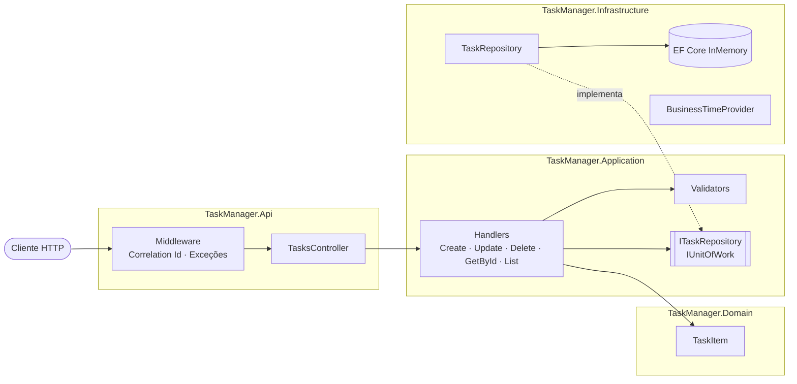

# Task Manager API

API RESTful para **gestão de tarefas** em **.NET 8**: cadastro, listagem com filtros, busca, ordenação e paginação, edição e exclusão.

  

> **Avaliação rápida:** `dotnet run --project src/TaskManager.Api` e abra `http://localhost:5000`.
> O ambiente de desenvolvimento sobe com tarefas de exemplo. Depois, `dotnet test`.
> As decisões de arquitetura estão em [`docs/adr`](docs/adr/README.md).

---

## Sumário

- [Como executar](#como-executar)
- [Endpoints](#endpoints)
- [Exemplos](#exemplos)
- [Arquitetura](#arquitetura)
- [Decisões técnicas](#decisões-técnicas)
- [Tratamento de erros](#tratamento-de-erros)
- [Observabilidade](#observabilidade)
- [Testes](#testes)
- [Engenharia](#engenharia)
- [Como estender](#como-estender)

---

## Como executar

**Pré-requisito:** [.NET SDK 8](https://dotnet.microsoft.com/download/dotnet/8.0) ou superior.

```bash
dotnet restore
dotnet run --project src/TaskManager.Api
```

| Recurso | URL |
|---|---|
| Swagger | http://localhost:5000/swagger |
| Health check | http://localhost:5000/health |

**Docker:**

```bash
docker build -t task-manager-api .
docker run --rm -p 8080:8080 task-manager-api
```

**Configuração** (`appsettings.json`):

| Chave | Padrão | Descrição |
|---|---|---|
| `Clock:TimeZone` | `America/Sao_Paulo` | Fuso de negócio usado para calcular "hoje" (validado na inicialização) |

O arquivo [`TaskManager.Api.http`](src/TaskManager.Api/TaskManager.Api.http) traz todas as requisições prontas.
O banco é **InMemory**, como pede o desafio: os dados são perdidos ao reiniciar a aplicação.

---

## Endpoints

| Método | Rota | Descrição | Sucesso | Erros |
|---|---|---|---|---|
| `GET` | `/api/tasks` | Lista com filtros, busca, ordenação e paginação | 200 | 400 |
| `GET` | `/api/tasks/{id}` | Obtém por código | 200 | 404 |
| `POST` | `/api/tasks` | Cria e retorna o código gerado (`id` + header `Location`) | 201 | 400 |
| `PUT` | `/api/tasks/{id}` | Atualiza título, descrição, vencimento e status | 200 | 400, 404 |
| `DELETE` | `/api/tasks/{id}` | Exclui | 204 | 404 |

### Modelo

| Campo | Tipo | Regras |
|---|---|---|
| `id` | `uuid` | Código único gerado pelo sistema |
| `title` | `string` | **Obrigatório**, até 100 caracteres |
| `description` | `string?` | Até 500 caracteres |
| `dueDate` | `date?` | `yyyy-MM-dd`. Na criação, não pode ser anterior a hoje (no fuso de negócio) |
| `status` | `enum` | `Pending` (Pendente), `InProgress` (Em progresso), `Completed` (Concluída). Padrão: `Pending` |
| `isOverdue` | `bool` | Calculado: vencida e não concluída |
| `createdAt` / `updatedAt` | `datetime` | UTC |

### Parâmetros da listagem

Todos são opcionais e combináveis:

| Parâmetro | Valores | Padrão |
|---|---|---|
| `status` | `Pending`, `InProgress`, `Completed` | todos |
| `dueDateFrom` / `dueDateTo` | `yyyy-MM-dd` (inclusivos) | sem limite |
| `search` | texto no título ou na descrição, case-insensitive | nenhum |
| `sortBy` | `DueDate`, `CreatedAt`, `Title` | `DueDate` (sem vencimento por último) |
| `sortDirection` | `Asc`, `Desc` | `Asc` |
| `page` / `pageSize` | `≥ 1` / `1–100` | `1` / `20` |

Para uma data exata, use o mesmo valor em `dueDateFrom` e `dueDateTo`.

---

## Exemplos

```bash
curl -i -X POST http://localhost:5000/api/tasks \
  -H "Content-Type: application/json" \
  -d '{"title":"Preparar apresentação","dueDate":"2026-12-31","status":"Pending"}'

curl "http://localhost:5000/api/tasks?status=Pending&sortBy=CreatedAt&sortDirection=Desc&page=1&pageSize=10"
```

```json
{
  "items": [
    {
      "id": "3f2b8c1e-9d4a-4b7e-8a61-2c5d9e0f1a23",
      "title": "Preparar apresentação",
      "description": null,
      "dueDate": "2026-12-31",
      "status": "Pending",
      "isOverdue": false,
      "createdAt": "2026-10-04T14:20:11.512Z",
      "updatedAt": null
    }
  ],
  "page": 1,
  "pageSize": 10,
  "totalCount": 1,
  "totalPages": 1,
  "hasNextPage": false,
  "hasPreviousPage": false
}
```

---

## Arquitetura

Camadas com dependências apontando para dentro e **um handler por caso de uso**
([ADR 0001](docs/adr/0001-arquitetura-em-camadas.md)).



```
src/
├── TaskManager.Domain/              Entidade e invariantes (zero dependências)
├── TaskManager.Application/
│   ├── Abstractions/                IUnitOfWork
│   ├── Common/                      Result/Error · paginação · ordenação · tempo · validação
│   └── Tasks/
│       ├── Create/ Update/ Delete/ GetById/ List/   um caso de uso por pasta
│       └── ITaskRepository · TaskResponse · TaskErrors · TaskRules · TaskMappings
├── TaskManager.Infrastructure/
│   ├── Persistence/                 DbContext · mapeamentos · repositório · consultas genéricas · seed
│   └── Time/                        Relógio de negócio
└── TaskManager.Api/                 Controllers · erros · middleware · Swagger · composição
tests/
├── TaskManager.UnitTests/           Domain · Validators · UseCases (um arquivo por handler)
├── TaskManager.IntegrationTests/    Api (ponta a ponta) · Persistence (EF Core real)
└── TaskManager.ArchitectureTests/   Camadas e convenções
docs/adr/                            Decisões de arquitetura
```

### SOLID

| Princípio | Onde |
|---|---|
| **SRP** | Um handler por caso de uso, com só as dependências que usa. Controller traduz HTTP; repositório consulta; validador valida. |
| **OCP** | Novo caso de uso = nova pasta, registrada por convenção. Nova listagem paginada reutiliza `PagedQuery` e `ToPagedResultAsync`. |
| **LSP** | Qualquer `ITaskRepository`, `IUnitOfWork` ou `TimeProvider` substitui o atual (os testes fazem isso). |
| **ISP** | `ITaskRepository` não salva; `IUnitOfWork` só salva. |
| **DIP** | A Application define as portas; a Infrastructure implementa. Verificado por teste de arquitetura. |

---

## Decisões técnicas

| Decisão | Por quê |
|---|---|
| **Handler por caso de uso** (sem MediatR) | Coesão, crescimento sem modificar código existente, dependências explícitas ([ADR 0001](docs/adr/0001-arquitetura-em-camadas.md)) |
| **Result pattern** | Assinaturas honestas; exceção só para o excepcional ([ADR 0002](docs/adr/0002-result-pattern.md)) |
| **Validação em duas camadas** | Regras de entrada no FluentValidation, invariantes no domínio ([ADR 0003](docs/adr/0003-validacao-e-tempo.md)) |
| **Relógio de negócio** | "Hoje" no fuso configurado, igual em qualquer servidor; fuso validado no startup ([ADR 0003](docs/adr/0003-validacao-e-tempo.md)) |
| **Paginação e ordenação genéricas** | Reutilizáveis por qualquer listagem; ordenação estável; `pageSize` limitado ([ADR 0004](docs/adr/0004-persistencia-consultas.md)) |
| **Unit of Work** | O caso de uso define a fronteira transacional ([ADR 0004](docs/adr/0004-persistencia-consultas.md)) |
| **Enums como texto, inteiros rejeitados** | Contrato legível, sem valores ambíguos |

---

## Tratamento de erros

Erros seguem **ProblemDetails** ([RFC 9457](https://www.rfc-editor.org/rfc/rfc9457)) com um `errorCode` estável:

```json
{
  "type": "https://tools.ietf.org/html/rfc9110#section-15.5.1",
  "title": "Um ou mais erros de validação ocorreram.",
  "status": 400,
  "errors": {
    "Title": ["O título é obrigatório."],
    "DueDate": ["A data de vencimento não pode ser anterior à data atual."]
  },
  "errorCode": "Validation.Failed",
  "traceId": "00-4bf92f3577b34da6a3ce929d0e0e4736-00f067aa0ba902b7-00"
}
```

| Situação | Caminho | HTTP |
|---|---|---|
| Entrada inválida | `Result` → `ApiControllerBase.ProblemFrom` | 400 |
| Tarefa inexistente | `Result` → `ApiControllerBase.ProblemFrom` | 404 |
| JSON malformado / enum inválido | Model binding | 400 |
| Violação de invariante | `GlobalExceptionHandler` (Warning) | 400 |
| Cliente cancelou | `GlobalExceptionHandler` (Information) | 499 |
| Erro inesperado | `GlobalExceptionHandler` (Error, sem detalhes fora de Development) | 500 |

---

## Observabilidade

- **Logs estruturados** com `[LoggerMessage]` (source generator) e EventIds estáveis.
- **`X-Correlation-Id`** em toda resposta, propagado se válido ou gerado; incluído no escopo de todos os logs
  da requisição e validado contra log injection.
- **Log de requisições** (método, rota, status e duração) via `Microsoft.AspNetCore.Hosting.Diagnostics`.
- **Health check** em `/health`, verificando o `DbContext`.

---

## Testes

```bash
dotnet test
dotnet test --collect:"XPlat Code Coverage"
```

| Suíte | Cobre |
|---|---|
| **UnitTests** | Invariantes da entidade; cada regra de validação (inclusive limites e fuso de negócio); cada handler nos cenários de sucesso, validação, não encontrado e cancelamento |
| **IntegrationTests / Persistence** | Filtros, busca, intervalos inclusivos, ordenação por campo e direção, desempate estável, paginação e `AsNoTracking` contra o EF Core real |
| **IntegrationTests / Api** | Contrato HTTP completo, ordenação, ProblemDetails com `errorCode`, enum inválido, correlation id, health e Swagger |
| **ArchitectureTests** | Dependências entre camadas, handlers selados e independentes entre si, repositórios internos |

Detalhes em [ADR 0005](docs/adr/0005-estrategia-de-testes.md).

---

## Engenharia

- **Central Package Management** (`Directory.Packages.props`) e **`Directory.Build.props`** compartilhado.
- **`.editorconfig`** com as convenções de código.
- **CI (GitHub Actions):** build, testes com cobertura e build da imagem Docker em todo push/PR.
- **Dockerfile multi-stage** com cache de restore e execução como usuário não-root.

---

## Como estender

A estrutura foi pensada para crescer **por adição**:

| Necessidade | O que fazer |
|---|---|
| Novo caso de uso (ex.: concluir tarefa) | Criar `Tasks/Complete/` com handler, request e validador; adicionar a action no controller |
| Nova listagem paginada | Herdar `PagedQuery`, `Include(new PagedQueryValidator())`, usar `ToPagedResultAsync` |
| Novo campo de ordenação | Adicionar ao enum `TaskSortField` e ao `switch` de ordenação do repositório |
| Banco relacional | Trocar o provider em `Infrastructure/DependencyInjection.cs` |
| Novo tipo de erro (ex.: conflito) | Adicionar ao `ErrorType` e ao mapeamento em `ApiControllerBase.ProblemFrom` |

Funcionalidades planejadas e onde cada uma se encaixa: [ADR 0006](docs/adr/0006-o-que-ficou-de-fora.md).
